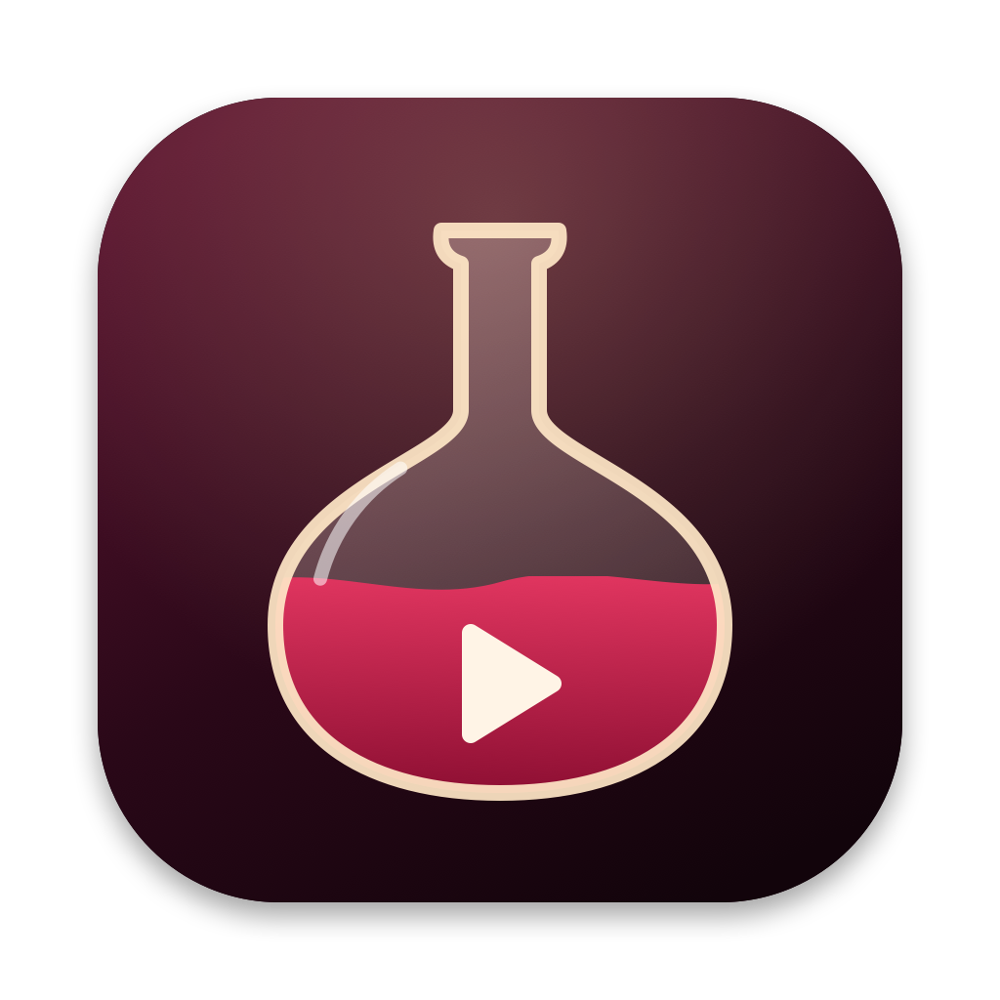

# Unwine

Free Steam Play for Windows games on Apple Silicon Macs. Install a Windows game in your normal
Mac Steam, and it runs through Unwine's free engine, like Proton on a Steam Deck.



## What Unwine does

- Downloads a free Wine 11 engine (Gcenx's Sikarugir build) with DXMT, DXVK and the KosmicKrisp
  Vulkan driver.
- Downloads the open Steam bridge parts from [NotProton](https://github.com/NotProtonNot/NotProton)
  and Valve's Windows Steam files, and builds a compatibility tool Mac Steam can use. It never needs
  CrossOver.
- Imports Apple's D3DMetal (Game Porting Toolkit 4) from your own download from Apple, for DirectX 12.
- Reads each game's files to pick the graphics layer: D3DMetal for DirectX 12, DXMT for DirectX 10/11,
  DXVK for DirectX 9.
- Per-game advice: the best layer (from tested Highball reports first, then the game's files), a
  "Best speed" and a "Best battery" setting set, and tips such as resolution limits for 32-bit games.
- Per-game settings: graphics layer, msync, AVX, Metal HUD, MetalFX sharpening (DXMT, DirectX 10/11),
  MetalFX for DLSS games, GPTK 4 Metal 4 mode, frame cap, Low latency (DXVK's Reflex-like latency
  sleep, for DirectX 8/9 games and the DXVK layer), background shader building (DirectX 8/9) and a
  120 fps mode (DXMT, for games that ask for 60 Hz on a faster screen). Your own choices always win:
  the advisor only suggests, and nothing is locked.
- Add game: any Windows program outside Steam, by its .exe or its folder. Each one gets its own Wine
  bottle and the same per-game settings. Programs from one game folder (a launcher and its game)
  share one bottle, so the launcher's settings reach the game. Right-click a game to play, rename or
  remove it.
- Fewer stutters: Unwine makes patched copies of DXVK's d3d9.dll (background shader building then also
  covers the screen's back buffers) and of the KosmicKrisp driver (the right memory budget under
  Rosetta). The downloaded files stay as they are.
- No crash and no black screen when a game shares a texture: some games decode videos with a
  DirectX 9 device and show them with DirectX 10/11 (Romance of the Three Kingdoms XIV). A Mac cannot
  share that picture, and DXVK then closed the game. Unwine's copies of DXVK's d3d9, d3d11 and dxgi
  DLLs carry on without the share, and the hidden DirectX 9 device no longer covers the game's window.
- No more DXMT freezes in 32-bit games: Unwine's copy of Wine lets the game's .exe decide DEP (Data
  Execution Prevention, a memory guard), as Windows does.
- Font stand-ins: Windows fonts such as Palatino Linotype use the Mac's Palatino, so launchers do not
  show blank buttons. Chinese, Japanese and Korean fonts (MS UI Gothic, SimSun, PMingLiU, Gulim and
  others) use the Mac's PingFang, Hiragino, Songti and Apple SD Gothic Neo, so dialogs in those
  languages show text, not boxes.
- Online mode for Valve Anti-Cheat (VAC) games (experimental): Windows Steam runs inside Unwine's engine,
  like CrossOver. It sees only the Windows games that need it, never your Mac versions of games, and uses
  the same game files as Mac Steam. Mac Steam closes while it runs. High Resolution Mode gives sharp
  text on Retina screens, "Games fill the whole screen" covers the Dock and menu bar, and "Close now"
  quits Windows Steam at once.
- macOS Game Mode turns on for games in fullscreen: Steam Play games, added games, and Online mode
  games (a switch in Settings).
- Games come to the front when they open, also with Stage Manager on.
- Updates itself: the engine (when Unwine can bridge it), Steam Play signature files, and the app.

## What it needs

- An Apple Silicon Mac with macOS 15 or newer, Rosetta, and Mac Steam.
- Steam Play switched on in Mac Steam, as described by the
  [NotProton project](https://github.com/NotProtonNot/NotProton). Unwine never changes Steam.app.

## Honest limits

- Games with a Mac version should use it. It has fewer layers, so less input lag and better battery.
- Online mode is not supported by Valve. VAC bans are permanent. No ban caused by Wine is known, but
  that is not a promise; try a spare account first if you worry. Unwine never changes game files and
  never uses insecure mode.
- There is no real NVIDIA Reflex on a Mac. DXMT and D3DMetal accept a game's Reflex calls but do
  nothing with them; Unwine's Low latency switch uses DXVK's own latency sleep instead.
- Games with kernel anti-cheat (Easy Anti-Cheat, BattlEye, Vanguard and others) do not run online on
  any Mac Wine tool, CrossOver included.
- A picture that a game shares between DirectX devices stays black, because the Mac's Vulkan driver
  cannot share it. In Romance of the Three Kingdoms XIV the videos are black (sound plays); Esc skips
  them, and the menus and the game itself draw normally.
- Some games run in CrossOver and not here: CodeWeavers has a paid team that fixes single games.
- GPTK 4 is an Apple beta. Rosetta 2 is fully supported through macOS 27 only.

## Build

Needs only the Xcode Command Line Tools.

```bash
bash scripts/build.sh      # builds dist/Unwine.app
bash scripts/make-dmg.sh   # packs dist/Unwine.dmg
```

`tools/steamplay` holds the Wine patch tools (from NotProton, GPL-3.0) and the generator for
`Sources/Unwine/SteamPlay/NtdllRecipes.swift`.

## Licence

GPL-3.0. See [LICENSE](LICENSE) and [NOTICE](NOTICE) for the parts Unwine uses and their licences.
